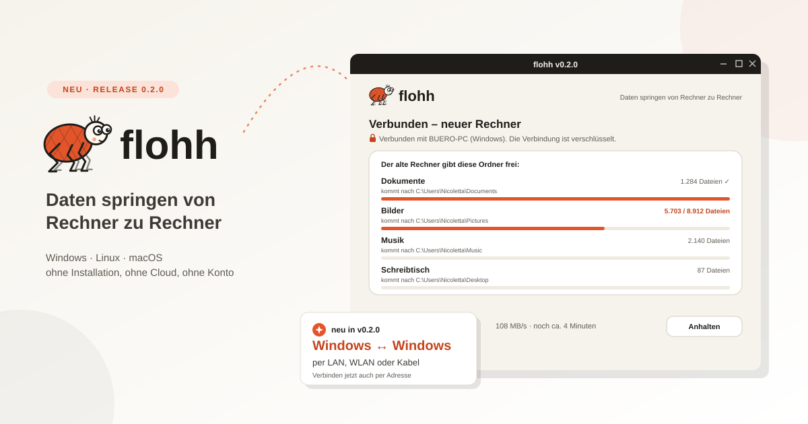

# flohh 0.2.0 – Daten springen von Rechner zu Rechner

**25. Oktober 2026**

Ein neuer Rechner ist schnell ausgepackt – aber dann kommt der Umzug. Dokumente, Fotos, Musik,
der volle Schreibtisch: Meist landet alles erst auf einer externen Festplatte oder in irgendeiner
Cloud, nur um ein paar Minuten später auf dem neuen Rechner wieder heruntergeladen zu werden.
Genau diesen Umweg spart **flohh**, mein neues Projekt: Die Daten springen direkt von Rechner zu
Rechner.

---

## Was ist flohh?

flohh ist eine **portable App** für den PC-Umzug – eine einzige Datei, die man auf beiden
Rechnern startet. Keine Installation, kein Konto, keine Cloud, kein externes Laufwerk. Die
Oberfläche öffnet sich einfach im Browser.

Und flohh ist nicht wählerisch: **Windows, Linux und macOS** in allen Richtungen, jeweils für
Intel/AMD und ARM. Vom alten Windows-Laptop auf den neuen Linux-Rechner? Kein Problem.

So läuft ein Umzug ab:

1. flohh auf **beiden** Rechnern starten.
2. Am neuen Rechner **„Empfangen“** wählen – er zeigt einen **6-stelligen Code**.
3. Am alten Rechner **„Senden“** wählen, den neuen Rechner aus der Liste nehmen und den Code
   eintippen. Die Verbindung ist ab jetzt **verschlüsselt** (TLS 1.3 + CPace).
4. Der alte Rechner gibt seine Ordner frei – Dokumente, Bilder, Musik, Videos, Schreibtisch,
   Downloads, auf Wunsch auch eigene oder versteckte Ordner wie AppData.
5. Der neue Rechner holt sie ab, und zwar gleich in **seine eigenen** Benutzerordner: „Bilder“
   landet unter macOS in „Pictures“, ohne dass man sich darum kümmern muss.

Dabei wird **nichts überschrieben** – gibt es eine Datei schon, heißt die neue „Name (2).ext“.
Bricht die Übertragung ab, setzt ein erneuter Start einfach dort fort, wo sie aufgehört hat.

---

## Neu in 0.2.0: Windows ↔ Windows

Version 0.1.0 hat heute Vormittag den Anfang gemacht, 0.2.0 schafft am Nachmittag den
häufigsten Umzug überhaupt: **vom alten auf den neuen Windows-PC**. Ein Windows-Rechner kann
jetzt auch Empfänger sein. Beim ersten Mal fragt die Windows-Firewall einmal nach – „Zugriff
zulassen“ klicken, fertig. Und blockt sie doch, sagt flohh das klar und mit Lösung, statt nur
„nicht erreichbar“ zu melden.

Getestet ist das **über LAN und über WLAN**.

Außerdem neu: **Verbinden per Adresse.** Manche Router trennen LAN und WLAN voneinander oder
filtern die Rundrufe, mit denen sich die Rechner sonst von selbst finden. Dann zeigt der neue
Rechner seine Adresse unter dem Code an, und am alten Rechner tippt man sie unter **„Rechner
nicht dabei? Adresse eingeben“** einfach ein.

> **Wichtig:** Beide Seiten stellen sich beim Verbinden jetzt gegenseitig vor – v0.2.0 arbeitet
> deshalb nicht mit v0.1.0 zusammen. Bitte auf beiden Rechnern dieselbe Version nehmen.

---

## Kabel, Router oder WLAN – was ist am schnellsten?

| Verbindung | Tempo (ca.) |
| --- | --- |
| **LAN-Kabel direkt** von Rechner zu Rechner | bis 110 MB/s (1 Gbit), bis 280 MB/s (2,5 Gbit) |
| **Über den Router** per LAN-Kabel | wie oben, je nach Router |
| **Über den Router** per WLAN | 5–60 MB/s |
| **Thunderbolt 3/4/5 oder USB4** direkt | 300 MB/s und mehr |
| **USB-LAN-Adapter** plus Kabel | je nach Adapter 35–280 MB/s |

Ein direktes LAN-Kabel klappt übrigens auch dann, wenn die Rechner völlig verschiedene
IP-Adressbereiche haben – flohh weicht dann auf IPv6 aus. Gast-WLANs lassen Geräte dagegen
meist nicht miteinander sprechen; dann lieber zum Kabel greifen.

---

## Download & Start

Am einfachsten ist das **ZIP mit allem**: Es enthält die Programme für alle Systeme, eine
Anleitung (`LIESMICH.txt`) und Prüfsummen (`SHA256SUMS.txt`). Auf einen USB-Stick gepackt hat
man damit für jeden Rechner die passende Datei dabei.

- **Windows:** Doppelklick auf `Flohh-Windows.exe`. Bei „Der Computer wurde durch Windows
  geschützt“ auf „Weitere Informationen“ → „Trotzdem ausführen“.
- **Linux:** Die Datei erst auf den Rechner kopieren, ausführbar machen und starten – ein
  Doppelklick direkt vom Stick reicht hier nicht. Auf Wunsch trägt sich flohh danach ins
  Anwendungsmenü ein.
- **macOS:** Die Dateien sind (noch) nicht von Apple notarisiert. Vom USB-Stick gestartet läuft
  flohh direkt, im Browser heruntergeladen einmal unter *Systemeinstellungen → Datenschutz &
  Sicherheit* „Dennoch öffnen“ klicken. Die Mac-Versionen sind bisher **ungetestet** – über
  Rückmeldungen freue ich mich besonders.

Alle Downloads gibt's auf der [Release-Seite bei GitHub](https://github.com/nicolettas-muggelbude/flohh/releases/latest).

---

## Open Source

flohh steht unter der **GPLv3**, das Logo und die Floh-Figur unter **CC BY-SA 4.0**. flohh ist
noch eine Vorabversion – bis 1.0.0 kann sich einiges ändern. Bugs, Ideen und Erfahrungsberichte,
gerade mit ungewöhnlichen Netz- oder Kabel-Konstellationen, sind auf GitHub sehr willkommen.

**Mehr Infos:** [GitHub](https://github.com/nicolettas-muggelbude/flohh) |
[Projektseite](https://muggelbude.it/projects/flohh.html)
